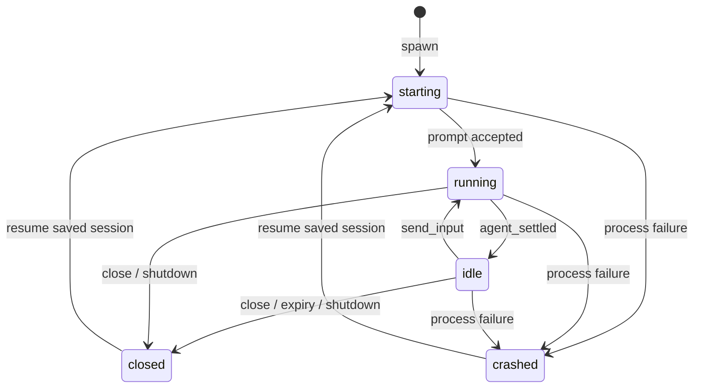

# Architecture

Each worker is a long-lived `pi --mode rpc --session …` process. The parent owns it directly; there is no background daemon.

## Boundaries

- `index.ts` adapts the Pi extension API, tools and notifications.
- `completion-inbox.ts` owns unread result snapshots and notification delivery; it does not orchestrate tasks.
- `pool.ts` owns worker lifecycles and orchestration.
- `rpc-client.ts` owns processes, request IDs, deadlines and shutdown.
- `jsonl.ts` handles strict LF framing; Unicode line separators remain valid string content.
- `registry.ts` persists metadata through atomic replacement.
- `account-selection.ts` handles credential-free pi-accounts selection metadata.
- `config.ts`, `selection.ts` and `pi-invocation.ts` handle configuration and launch selection.
- `session-cost.ts` sums Pi's own session ledgers for the footer total.

## Persistence and cleanup

Storage lives under `<Pi agent directory>/persistent-subagents/parents/<parent-scope>/`. A parent scope contains a registry and each worker's session JSONL. Registry files use owner-only file permissions; task text and output are local sensitive data even though credentials are not registry fields.

Settling keeps a worker alive. Explicit close, configured idle expiry, or parent shutdown ends its process. Session files remain for resume. On reload, persisted live-looking entries are treated as closed; metadata does not mean an old process has been adopted.

The installed Pi runtime also handles stdin closure and signals. Automated live tests exercise parent termination with idle and active workers and their shell descendants. These tests are platform/runtime-specific evidence, not a guarantee against every external crash scenario.

## Cache and usage

Three distinct properties matter:

1. **Transcript continuity:** a saved session survives process restarts.
2. **Prompt-cache eligibility:** provider-controlled reuse of an input prefix.
3. **Process-local continuation:** transport/session state held in a live process.

Persistent workers preserve the third property while the process lives. Resume restores the first but starts a new process. Pi's Codex implementation may reuse sockets and previous-response state, subject to its own TTLs and reconnection policy.

## Cost in the footer

When the session has workers, the footer shows `Σ <total> · main <parent> · workers <all workers>` through `ctx.ui.setStatus`, next to Pi's own footer fields. Every figure is Pi's own session total, computed the way `get_session_stats` computes it (assistant, tool, compaction, branch-summary and cache-warming usage, over every entry of the session file), so compaction, retries, resumes and reloads are counted once: the total is recomputed from the session files, never accumulated from events. Closed and resumed workers count, and so do nested workers, found through each worker session's own registry. If a worker that has run has no readable session file, the total is marked `+?` as a lower bound rather than shown as exact. These are API-equivalent estimates from the model catalog (or provider-reported totals where Pi has them), not a bill or subscription quota. `/pmetrics` remains the place for per-day, per-model and per-project analysis.

## Usage counters

Usage is accumulated from actual assistant message events: `input`, `output`, `cacheRead`, `cacheWrite`, and `turns` (assistant messages with usage, including intermediate tool-use messages). Cache tokens can be reported after process restarts too. No fixed hit rate, speedup, billing or subscription-quota saving is promised.

## Compatibility

The supported line is Pi `^1.6.0` (tested: 1.6.0). Offline process tests, declaration checks, and an installed-Pi suite that drives real Pi RPC against a local mock model cover the extension boundary without paid calls. Live provider tests are opt-in. See [testing](testing.md) for reproducible commands and scope.

What Pi provides natively since 0.85, and what this extension does with it:

| Pi primitive (version) | Native to Pi | This extension |
| --- | --- | --- |
| `prompt` with `streamingBehavior` and `disposition` (0.99) | Atomic start-or-queue | `send_input` uses it instead of `get_state` + `steer`/`follow_up`; reports the disposition; a `handled` input leaves the worker idle. |
| `agent_settled.aborted` (1.1) | Marks aborted runs | An interrupt's aborted run is not a result; other aborts are `outcome: aborted`. |
| `--provider` requires `--model` (1.x) | Enforced at startup | The provider is always paired with a model; see [selection](configuration.md#selection). |
| Orderly RPC shutdown on stdin EOF/SIGTERM, waits for token refresh (1.5.1) | Yes | Stop closes stdin and sends SIGTERM, keeps draining stdout, and waits `shutdownGraceMs` (10 s) before SIGKILL. |
| Prompt-cache warming, `cacheWarming: idle` default, `cache_warming_decision` (0.86, 1.5.1) | The only warmer | No second warmer. `reuse: one_shot` returns `stop` from the worker's decision hook. |
| `PI_CACHE_RETENTION=long` | Provider-specific long TTLs | Set per worker by `cacheRetention: long`. |
| `get_session_stats` (`cost`, `contextUsage`) and `compact` RPC | Yes | Context budget check before new input; `list_agents(verbose)` context view. |
| Per-model `compaction.reserveTokens` overrides (0.86) | Global/project settings only | Not usable per worker: a worker-scoped budget would change every session in the project. Hence the prompt-boundary budget. |
| `ctx.ui.setStatus` | Footer status slot | Main + workers cost total. |
| Session cost total | `/session`, footer, `get_session_stats` | Recomputed with the same rules for workers; the e2e suite checks equality with Pi. |
| Extension changelog on update (1.5) | Reads `CHANGELOG.md` | This package ships one. |
| Tool validation by `pi-schema` (1.5) | JSON Schema plus coercion | Schemas are plain JSON Schema (`Type.Object`, literals, integer bounds); no TypeBox-only features. |
| `before_provider_headers` no longer sees Pi's own attribution headers (1.4) | Pi sets default attribution | Only non-default attribution (models.json headers, other extensions) is observed and passed to OpenRouter workers, which is the intent. |

Not verified against a live provider in this release: Anthropic message threads (1.5.1) and their effect on reported cache usage, and OpenRouter attribution with the 1.4 header change. The mock-model suite covers OpenAI-compatible completions.
